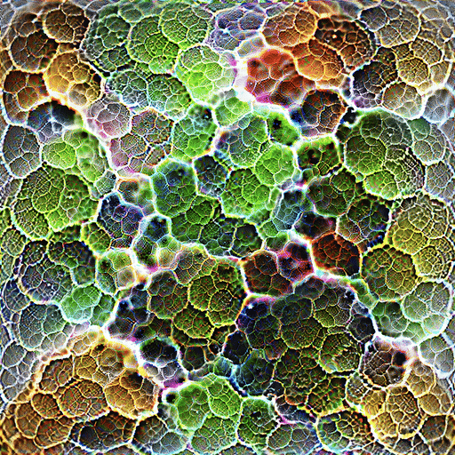

# Cell warp loop (GoogLeNet `inception4e`, channel 198)

<p align="center"></p>

Two descriptions of the same render: one for people who want to know what they are looking at, one for people who want the loss function.

## For everyone

An image classifier is a stack of filters. Each filter responds to some pattern, and you can find out which by starting from noise and nudging the pixels until that one filter fires as hard as it can. The still image this loop is built from was made that way for a single filter deep inside GoogLeNet. Nobody drew the cells; the filter wanted them, and the picture is the strongest "cells" it could be shown. Before this loop existed the picture had one more round of training, in which it was gently swirled around and the filter had to keep firing throughout, so it was already a picture that holds up when it moves.

To animate it we found the cells in the filter's own picture, the way a cell biologist would outline a micrograph, and gave every cell room to move: each one may slide a few pixels with its neighbours, slide a little on its own, and grow or shrink by a few percent, all on a loop that returns exactly to the start. The filter then judges every frame. Any motion that makes it fire less is pushed back; motion it does not mind stays. So the cells drift and breathe the way this one filter is willing to have cells drift and breathe, and nothing in the picture is painted in that the filter did not ask for.

The last step is cosmetic. Every frame is enlarged four times by an off-the-shelf upscaling network and then shrunk back to its original size. That round trip sharpens the cell outlines and raises the contrast, at the price of smoothing the finest speckle inside the cells.

## For the technical reader

**Still.** $P \in \mathbb{R}^{3 \times S \times S}$, $S = 1024$, is the pre-sigmoid image of a periodic (torus) feature-visualization still for channel 198 of `inception4e`, rendered with the decorrelated Fourier parameterization of Olah et al. (2017), multi-scale 512 px crops as transformation robustness, a hinge keeping $|P| \le 2.94$ (so pixels stay inside $[0.05, 0.95]$), and a cap on pixel-scale chroma. It is made in two steps. First, three anchors are rendered from 224 px up to 1024 px in octaves (`ring.py --anchors-only`). Then anchor 0 is re-optimized for the channel score averaged over the frames of a looping swirl: a divergence-free displacement field made of four low spatial modes, peaking at 17.9 px with strain below 0.18, so the warp never folds (`warploop.py --speed 0.5`, 300 steps). That raises the still's own score from 9.50 to 10.01, so $P$ is a still that has already learned to survive being moved. $I_0 = \sigma(P)$ is the still. The channel score of any image $I$ is

$$a(I) = \mathbb{E}_{\text{crop}}\big[\,\text{mean}_{x,y}\, f_{4e,198}(\text{crop}(I))\,\big],$$

the spatial mean of the channel's activation, averaged over random multi-scale crops. For $I_0$, $a = 10.01$.

**Segmentation.** A two-level marker watershed on luminance ridges of $I_0$ gives domains $\mathcal{D}$ (165, median diameter 84 px, bounded by the bright membranes) and cells $\mathcal{C}$ (1132, median diameter 32 px), every cell $c$ lying in one domain $\delta(c)$. Cell $c$ has region $R_c$, circular-mean centroid $\mu_c$ and area $A_c$. $B$ is the membrane band, the 15 % of pixels with the highest ridge response.

**Membership.** Each pixel $x$ belongs softly to the cells near it:

$$\tilde w_c(x) = \exp\!\left(-\frac{\operatorname{dist}(x, R_c)^2}{2\sigma(x)^2}\right), \qquad \sigma(x) = \begin{cases} 7 \text{ px} & x \in B \\ 3 \text{ px} & \text{otherwise,}\end{cases}$$

keeping the four largest $\tilde w_c(x)$ per pixel and normalizing them to $w_c(x)$, $\sum_c w_c(x) = 1$. Inside $R_c$ the distance is zero, so $w_c = 1$ there and the blend happens only across the walls.

**Paths.** Every quantity that moves is a trigonometric polynomial in the loop phase $t \in [0, 1)$ with three harmonics and no constant term,

$$p(t) = \sum_{k=1}^{3} a_k \cos 2\pi k t + b_k \sin 2\pi k t,$$

so each path is periodic and averages to zero over the loop. There are three families: domain drift $\Delta_D(t) \in \mathbb{R}^2$ for each domain, and cell drift $\delta_c(t) \in \mathbb{R}^2$ and breathing $s_c(t) \in \mathbb{R}$ for each cell. Their coefficients are the only optimized variables: $(165 \cdot 2 + 1132 \cdot 3) \cdot 6 \approx 22{,}000$ numbers.

**Displacement.** Cell interiors translate with their domain and themselves and scale about their centroid; the walls take the strain:

$$u(x, t) = \sum_c w_c(x)\,\Big[\Delta_{\delta(c)}(t) + \delta_c(t) - s_c(t)\,(x - \mu_c)\Big].$$

**Frame.** With $P(x)$ sampled by periodic bicubic interpolation, the frame is $I_t(x) = \sigma\big(P(x + u(x,t))\big)$. It is a pure warp of the still: no pixel value is invented.

**Loss.** For a minibatch of four random phases $t$,

$$\mathcal{L} = -a(I_t) + |a(I_t)|\,\Big[\,4\, L_{\text{amp}} + 2\, L_{\text{area}} + 0.2\, L_{\text{coh}}\Big],$$

where the priors are scaled by the activation so their weights are dimensionless, and

$$L_{\text{amp}} = \frac{1}{3}\sum_{p \in \{\Delta, \delta, s\}} \operatorname{mean}_c \Big(\frac{\operatorname{rms}_t\, p_c}{\tau_p} - 1\Big)^2, \qquad \tau = (6 \text{ px},\ 2.5 \text{ px},\ 0.08),$$

holds each path family near a target amplitude, so the loop keeps moving instead of collapsing to the still;

$$L_{\text{area}} = \operatorname{mean}_{t, D} \left(\frac{1}{\tau_s}\, \frac{\sum_{c \in D} A_c\, s_c(t)}{\sum_{c \in D} A_c}\right)^2$$

makes breathing zero-sum within every domain, so when a cell grows its neighbours give way; and

$$L_{\text{coh}} = \operatorname{mean}_{t,\ (c, c') \in \mathcal{E}} \ \ell_{cc'}\, \frac{\|\delta_c(t) - \delta_{c'}(t)\|^2}{\tau_\delta^2}$$

pulls the drifts of wall-sharing neighbours together, weighted by their shared wall length $\ell_{cc'}$ (normalized to mean 1).

**Projection.** After every optimizer step each path is rescaled so that $\max_t |p_c(t)|$ does not exceed its cap: 12 px for $\Delta$, 5 px for $\delta$, 0.14 for $s$.

**Training.** Adam, learning rate 0.02 with cosine decay, 600 steps, about two minutes on an M5 Max. 240 frames at 30 fps, an 8 s loop.

**Round trip.** Each frame goes through Real-ESRGAN x4plus to 4096 px and back to 1024 px with a Lanczos filter. Nothing is optimized here; it is a fixed post-process.

**Result.**

| | channel score $a$ | rms motion over the loop |
|---|---|---|
| still | 10.01 | |
| warped loop, mean over frames (min) | 9.27 (9.18) | domain 5.7 px, cell 2.4 px, breathing 6.6 % of radius |
| after the round trip | 9.14 | unchanged |

The motion costs the channel 7.4 % of its score, and the round trip another 1.5 %. The round trip raises band energy 17 to 19 % at 4 to 64 px and 4 % at 1 to 4 px, puts 5 % of colour values within 2 % of the rails, and leaves frame-to-frame change and optical-flow scores within 2 % of the warped loop.

## Reproducing it

From the repo root (the Real-ESRGAN weights go in `models/`). The still and its labels, if you want to make them rather than use `assets/`:

```bash
uv run python experiments/loops/ring.py --net googlenet --target inception4e:198 \
  --size 1024 --anchors-only --out outputs/ring4e198
uv run python experiments/loops/warploop.py --anchors outputs/ring4e198/anchors.pt \
  --net googlenet --target inception4e:198 --speed 0.5 --out outputs/still4e198
uv run python experiments/loops/seg.py outputs/still4e198/base.png outputs/seg4e198 \
  --r1 32 --b1 5 --r2 11 --mb2 4
```

The loop, the round trip and the GIF:

```bash
uv run python experiments/loops/cellwarp.py \
  --base experiments/loops/assets/base.pt --labels experiments/loops/assets/labels_4e198.npz \
  --target inception4e:198 --out outputs/cellwarp-4e198 \
  --amp-D 12 --amp-d 5 --amp-s 0.14 --tgt-D 6 --tgt-d 2.5 --tgt-s 0.08 --wamp 4 \
  --paths experiments/loops/assets/W5_paths.pt      # omit to train new paths
uv run python upscale.py --frames outputs/cellwarp-4e198 --down 1024 --no-gif
ffmpeg -framerate 30 -i outputs/cellwarp-4e198_x4_down1024/f%04d.png \
  -vf "fps=10,scale=512:512:flags=lanczos,split[a][b];[a]palettegen=stats_mode=full[p];[b][p]paletteuse=dither=sierra2_4a" \
  -loop 0 docs/4e198-cellwarp.gif
```

The numbers in the result table:

```bash
uv run python experiments/loops/measure.py loop outputs/cellwarp-4e198 \
  outputs/cellwarp-4e198_x4_down1024 --out outputs/cellwarp-4e198_scores.json
uv run python experiments/loops/measure.py compare outputs/cellwarp-4e198 \
  outputs/cellwarp-4e198_x4_down1024 --out outputs/cellwarp-4e198_scores.json
```

With `--paths` the frames match the README loop exactly, and `seg.py` reproduces `assets/labels_4e198.npz` exactly. Anything trained does not repeat bit for bit, because the MPS backward pass is not deterministic: rebuilding the still gives the same picture with small fine-scale differences (mean 5.7 levels of 255, score 9.872 against 9.868 averaged over the swirl), and training new paths gives a loop of the same character but not the same frames.

## Variant: content inside the cells

`--hue 0.12 --scroll 1.5 --res 0.5`, at the default half amplitudes, adds three more path families: a per-cell hue rotation about the grey axis (zero-sum per domain, so local mean colour stays put), a scroll of the fine texture inside each cell's core, and an optimized two-harmonic residual texture inside the cores. Each comes with a matching amplitude target and the hue gets its own zero-sum term. That render (C4) scores 9.75; its paths are `assets/C4_paths.pt`.

## Files

| file | what it is |
|---|---|
| `ring.py` | the still's anchors with `--anchors-only`; otherwise a ridge-walk loop. Its `Ring` class supplies the channel score and the still's parameterization |
| `warploop.py` | re-optimizes an anchor under a looping swirl warp; makes the still |
| `smooth.py` | smooths a ridge-walk loop under a space-time speed limit; `warploop.py` uses its `turns` |
| `seg.py` | the segmentation and membrane band |
| `cellwarp.py` | the loop |
| `measure.py` | loop scores (activation, contrast swing, motion explained by optical flow) and before/after comparisons |
| `flowfade.py` | the optical-flow measure: how much of each frame-to-frame change is explained by moving pixels (RAFT) |
| `content.py` | hue-swing and interior-change metrics for a finished loop |
| `cells.py` | path, sampling and blur helpers; also an earlier, abandoned tissue model |
| `octave.py`, `zoo.py` | octave renders across backbones, and the multi-scale crop used for every score |
| `assets/` | the still (`base.pt`, `base.png`), its labels, and the trained paths `W5_paths.pt` and `C4_paths.pt` |
